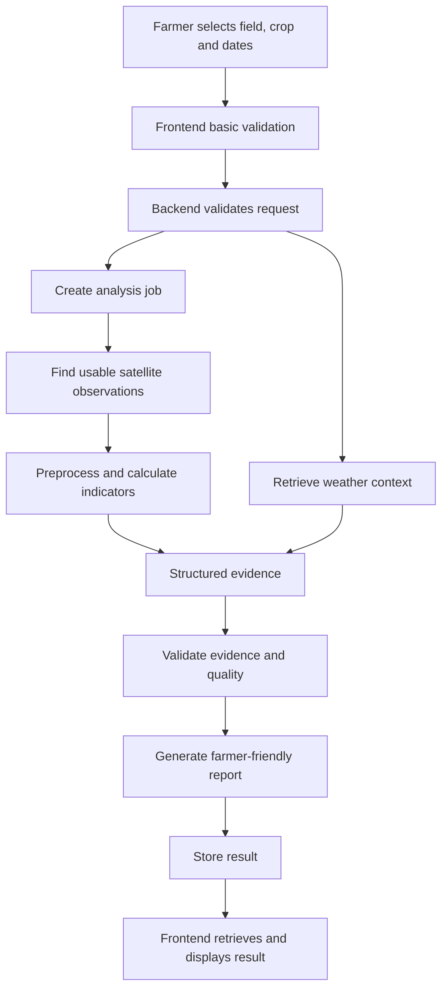

# Data Flow

## Farmer input
Proposed inputs: field polygon (GeoJSON; coordinate convention to be agreed), crop, date range and report language. Backend validates geometry, coordinate ranges, area limits and dates.

## Geospatial output
Return structured values, not prose only: source/product IDs, observation dates, processing time, cloud/valid-pixel quality, NDVI values and aggregation method, comparisons, and potential inundation indicator/method/limitations if supported.

## Weather output
Include provider, retrieval time, requested period, measurements with units (e.g. rainfall in mm) and missing-data flags.

## AI reporting
The AI module checks schema and quality, distinguishes observations from possible interpretations, repeats numeric values exactly, states dates and limitations, and avoids diagnosis/prescriptions.

## Failure paths
Invalid geometry: reject clearly. No suitable imagery: inconclusive. Weather unavailable: mark unavailable, do not invent. Processing error: safe error and diagnostic log reference. LLM unavailable: deterministic fallback or clearly marked partial result.
