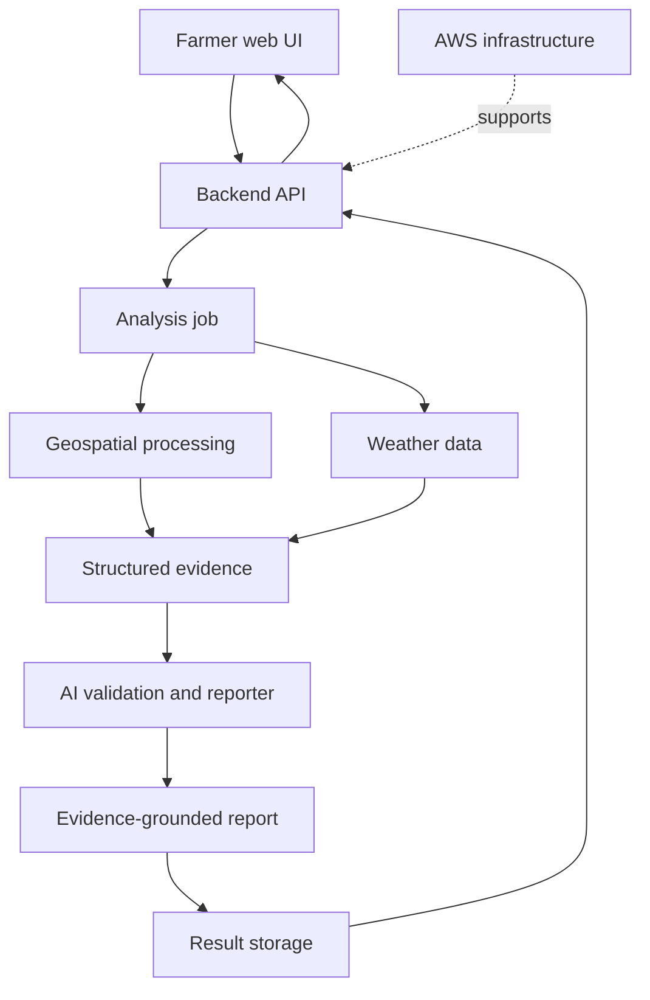

# System Architecture

This is a proposed design, not proof of implementation or deployment.

## Components and owners
| Component | Folder | Owner | Responsibility |
|---|---|---|---|
| Frontend | `frontend-mehul/` | Member 4 | Field input, map, job status, charts and reports |
| Backend API | `backend-amit/` | Member 1 | Validation, jobs, orchestration, persistence and APIs |
| Cloud | `infrastructure-amit/` | Member 1 | AWS, IAM, deployment, logs, budgets and security |
| Geospatial | `geospatial-snehendu/` | Member 2 | Satellite retrieval, preprocessing, quality and indicators |
| AI agents | `agents-devesh/` | Member 3 | Evidence validation, orchestration and farmer-friendly reporting |
| Shared contracts | `shared/` | All, coordinated | Agreed schemas and interfaces |

## Logical architecture

## Recommended processing pattern
For longer satellite work, use an analysis job: API validates and returns a job ID; a worker performs geospatial/weather processing; the reporter consumes structured evidence; results/status are stored; frontend retrieves status and result. The team must choose the actual queue/worker runtime. Do not assume heavy raster processing belongs in one synchronous request or one Lambda invocation.

## Reliability
Record source IDs, observation timestamps, processing version and quality flags. Handle invalid polygons, no-data, clouds, stale imagery, provider errors and timeouts. Use least-privilege AWS permissions. Keep secrets out of source control.

## Open decisions
Backend runtime, worker/queue design, storage schema, authentication, geospatial libraries, satellite access, Bedrock availability/fallback, AWS region and cost controls.
